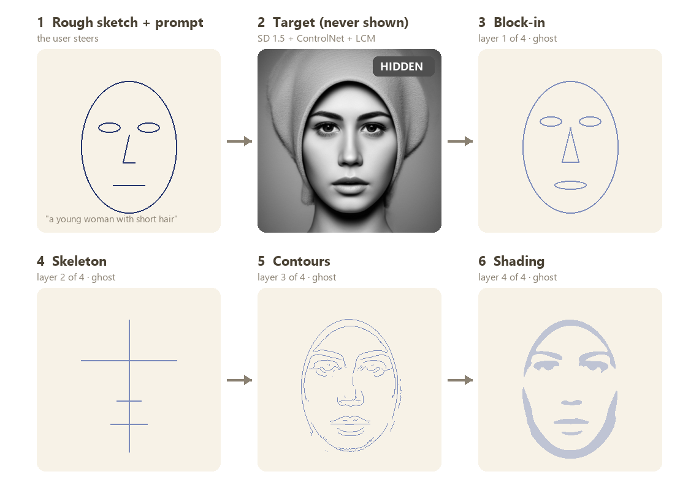
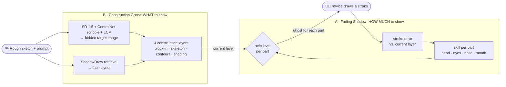
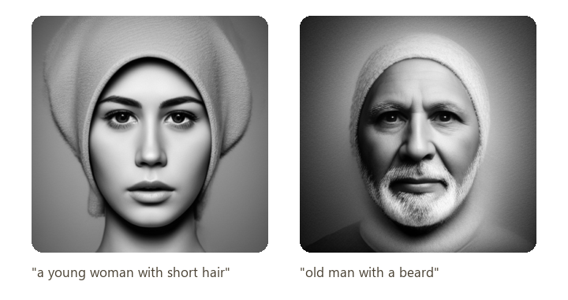
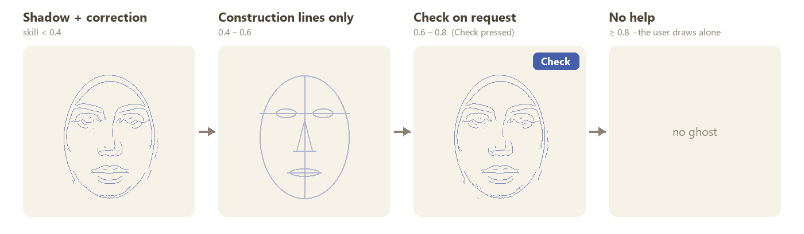
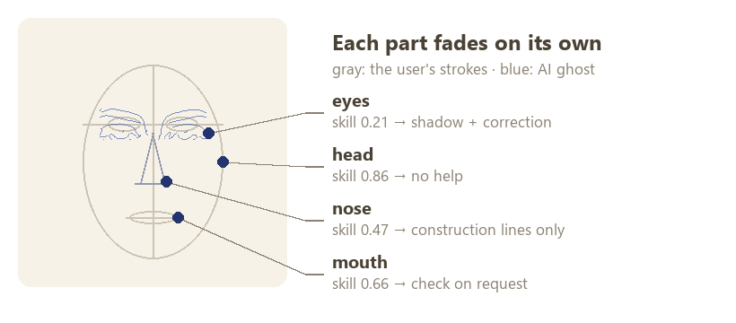

<div align="center">

# ✏️ SketchFade

**AI as a drawing teacher, not a drawing replacement.**

A drawing coach for novices that generates *the steps, not the picture*,
and steps back as you improve.




</div>

---

## Why

Sketch-to-image systems such as **DeepFaceDrawing** and **AniFaceDrawing** turn two
rough strokes into a finished portrait. **ShadowDraw** guides strokes with a live
shadow, and **PortraitSketch** corrects them. The result looks better, but users
report they *couldn't draw it again*: the AI drew it, the user only steered.

> **How can AI help novices draw better now, and still draw well without it later?**

SketchFade combines two of our proposals:

| | Proposal | Decides | Idea |
|---|---|---|---|
| **B** | **Construction Ghost** | *what* to show | Generate a target from the sketch, keep it **hidden**, and show only the **next construction step** as a ghost. |
| **A** | **Fading Shadow** | *how much* to show | Measure every stroke, estimate **skill per face part**, and **fade the help** for each part as that skill grows. |

## How it works



1. **Sketch & prompt.** A rough face sketch gets a live ShadowDraw shadow, which also
   tells us where the face sits on the canvas.
2. **Generate a hidden target.** The sketch (ControlNet *scribble*) and a text prompt
   drive Stable Diffusion 1.5 with an LCM-LoRA (4 steps). Like DeepFaceDrawing /
   AniFaceDrawing, the sketch steers the face, **but the image is never shown.**
   **Regenerate** tries a new seed, so the user stays in charge of the target.

   <p align="center"></p>

3. **Decompose into construction layers**, the way artists build a portrait:
   `block-in` (big shapes) → `skeleton` (axis and proportion lines) → `contours`
   (edges of the target) → `shading` (darkest value masses).
4. **Draw layer by layer.** Only the current layer appears as a ghost.
5. **Help fades per part.** Every stroke is scored (mean distance to the nearest guide
   pixel), assigned to a face part, and updates that part's skill:

<p align="center"></p>

| skill | help level | what the user sees for that part |
|:---:|---|---|
| < 0.4 | **shadow + correction** | ghost of the current layer; strokes are gently snapped to it |
| 0.4 – 0.6 | **construction lines only** | faint block-in / skeleton lines |
| 0.6 – 0.8 | **check on request** | nothing, until the user presses **Check** |
| ≥ 0.8 | **no help** | nothing: the user draws alone |

<p align="center"></p>

Help also comes **back** when a part gets worse. A **Test mode** hides all help for
pre/post tests without AI, and every stroke is logged for the learning study.

## Quick start

```bash
git clone https://github.com/DikkiKartajaya/sketchfade.git
cd sketchfade/app
pip install -r requirements.txt
python generate.py     # once: downloads the models (~3 GB) and renders a test target
python server.py       # → http://127.0.0.1:9100/
```

On Windows you can also double-click `app/run.bat`.

| Hardware | Time per target |
|---|---|
| CPU (Intel Core Ultra 5, measured) | ~46 s |
| NVIDIA GPU (e.g. RTX 6000 Ada, expected) | ~1 s |

No GPU and no `diffusers`? The app still runs: it falls back to the ShadowDraw
database face as the target (no shading layer). To run on a remote GPU server
behind an SSH tunnel, see [`app/README.md`](app/README.md#run-on-a-gpu-server-eg-rtx-6000-ada).

## Using the app

| Control | What it does |
|---|---|
| **Prompt** + **Generate target** | build the hidden target from your rough sketch |
| **Regenerate** | new seed, new target |
| **← / →** | previous / next construction layer |
| **Check** | reveal the current layer for parts at *check on request* (2 s) |
| **Pen width** | stroke thickness (1–12 px) |
| **AI help strength** | ghost opacity and strength of the stroke correction (0–100 %) |
| **Test mode** | hide all help; strokes are still scored and logged |
| **Save session** | write the stroke log to `app/sessions/*.json` |

Everything the server does (requests, targets, every stroke with its error, help
level and skill, help-level changes, and full tracebacks) goes to the console and
`app/logs/sketchfade.log`. Generated targets are saved to `app/targets/`.

## Repository

```
sketchfade/
├── app/                    SketchFade (A + B)
│   ├── generate.py         B · sketch + prompt → hidden target (SD + ControlNet + LCM)
│   ├── ghost.py            B · target → 4 labeled construction layers
│   ├── fading.py           A · stroke error, skill per part, help policy
│   ├── server.py           HTTP API, session state, run log
│   └── static/index.html   drawing UI
├── shadowdraw-demo/demo/   ShadowDraw reimplementation + face database (retrieval, layout)
└── docs/                   README figures
```

## Roadmap

- [ ] Pilot with 3 users, then a multi-session study (12 novices × 3 sessions, unassisted pre/post test)
- [ ] Layers from SAM + edge detection, so the coach works for any subject, not only faces
- [ ] **C · Paper Coach**: the same policy and guides on real paper through a phone camera

## Built on

- Y. J. Lee, C. L. Zitnick, M. F. Cohen. **ShadowDraw**: Real-Time User Guidance for Freehand Drawing. SIGGRAPH 2011.
- S.-Y. Chen et al. **DeepFaceDrawing**: Deep Generation of Face Images from Sketches. SIGGRAPH 2020.
- Z. Huang et al. **AniFaceDrawing**: Anime Portrait Exploration during Your Sketching. SIGGRAPH 2023.
- J. Xie et al. **PortraitSketch**: Face Sketching Assistance for Novices. UIST 2014.
- E. Iarussi, A. Bousseau, T. Tsandilas. **The Drawing Assistant**. UIST 2013.
- D. Dixon, M. Prasad, T. Hammond. **iCanDraw?** CHI 2010.
- L. Zhang, A. Rao, M. Agrawala. **ControlNet**. ICCV 2023 · S. Luo et al. **LCM-LoRA**. 2023 · R. Rombach et al. **Stable Diffusion**. CVPR 2022.

## Team

Course project for *I665E Human–AI Interaction Exercise II*.

**Berlian Angga Kusuma** · **Dikki Yusuf Kartajaya** · **Muhammad Ariful Furqon**
