<div align="center">

# ✏️ SketchFade

### Adaptive Fading of Generated Construction Guides for Novice Drawing

*AI as a drawing **teacher**, not a drawing **replacement**.*<br>
SketchFade generates **the steps, not the picture**, and steps back, face part by face part, as you improve.


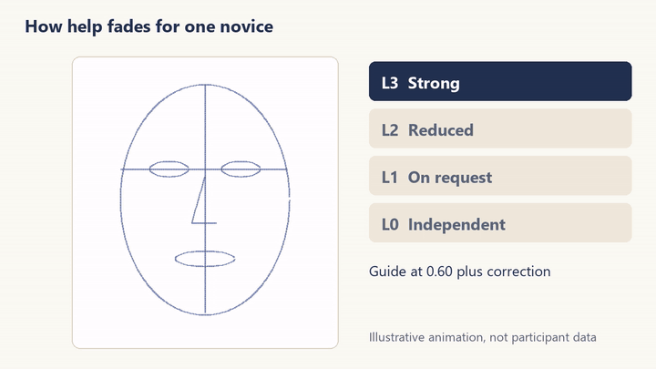

<sub>Illustrative animation of how help fades for one face part, from L3 *Strong* to L0 *Independent*.</sub>

[**How it works**](#-how-it-works) · [**Pilot results**](#-pilot-study-results) · [**Quick start**](#-quick-start) · [**Team**](#-team)

</div>

---

## 💡 The idea in one picture

<p align="center">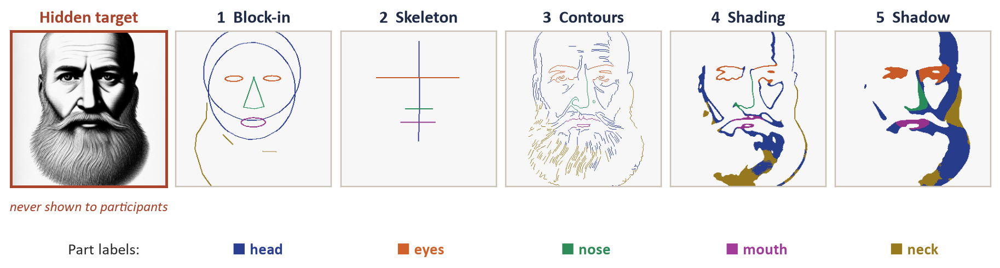</p>

1. A rough sketch + a text prompt → **Stable Diffusion + ControlNet** generates a target portrait.
2. The target is **never shown**. It is turned into **five construction layers**, in the order an artist builds a portrait.
3. Every pixel is labelled with a **face part**, so help can **fade per part**, decided by short *unassisted* redraws.

> **Judge AI drawing help by what people draw once it steps back.**

## 🤔 Why

AI drawing tools such as **ShadowDraw**, **PortraitSketch** and **AniFaceDrawing** guide, correct or finish a
novice's drawing, and the result looks better *right away*. But a drawing made with help does not show what
the novice can draw **alone**. Scaffolding theory suggests another role for the AI:

<p align="center"><b>Support&nbsp;&nbsp;→&nbsp;&nbsp;Fade&nbsp;&nbsp;→&nbsp;&nbsp;Hand over</b></p>

| System | What it provides | Fades per part | Tested without help |
|---|---|:---:|---|
| ShadowDraw (2011) | Live contour shadow | ✗ | ✗ |
| Drawing Assistant (2013) | Guides extracted from photos | ✗ | Partly |
| PortraitSketch (2014) | Stroke correction | ✗ | ✗ |
| DrawMyPhoto (2019) | Stages and feedback | ✗ | Future work |
| AniFaceDrawing (2023) | Generated portraits | ✗ | ✗ |
| Chen et al. (2025) | Generated guidance sketches | ✗ | ✗ |
| **SketchFade (ours)** | **Generated construction steps** | **✓** | **Probes, post-test** |

### Research questions

| | Question | Measured by |
|---|---|---|
| **RQ1** | Does fading the construction guide improve unassisted drawing compared with fixed full guidance? | Rubric, probe scores |
| **RQ2** | How do novices use the layered steps, and how does that relate to probe success per part? | Drawings and logs per step |
| **RQ3** | How do fading and choosing among candidates affect ownership, control and workload? | Questionnaire, NASA-TLX |

Both conditions get **the same generated guides**, so any difference comes from fading, not from guide content.

## 🔧 How it works

<p align="center">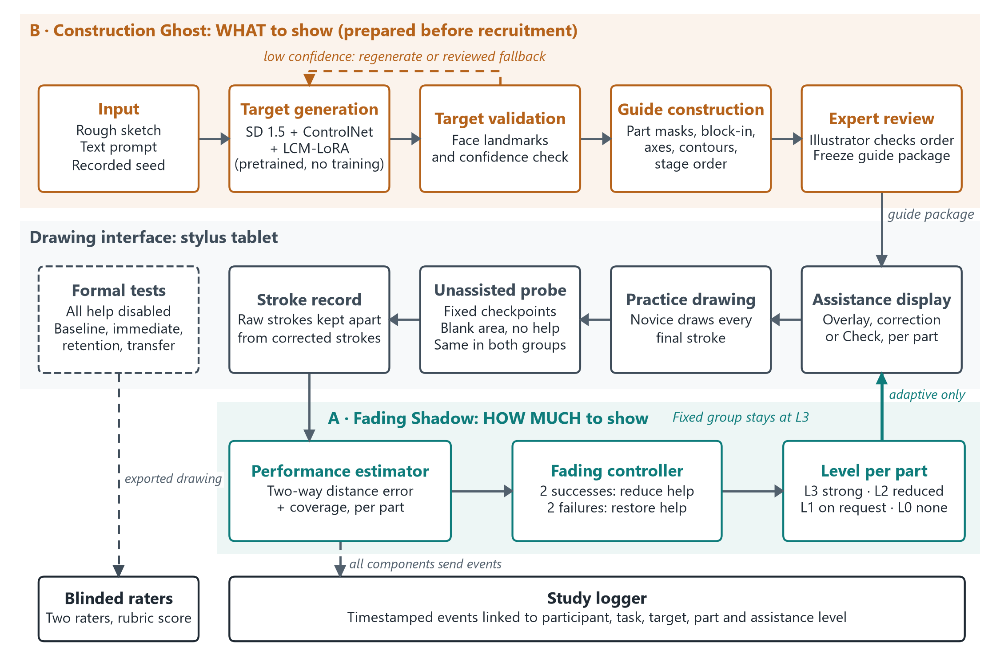</p>

SketchFade combines two ideas:

| | Component | Decides | How |
|:---:|---|---|---|
| 👻 **B** | **Construction Ghost** | *what* to show | Generate a hidden target, then reveal only the **next construction step**. |
| 🌗 **A** | **Fading Shadow** | *how much* to show | Lower the help **for each face part** as *unassisted* performance improves. |

### 👻 B · Construction Ghost: from rough sketch to frozen guide package

| Step | What happens |
|---|---|
| **Generate** | SD 1.5 + ControlNet *scribble* + LCM-LoRA, **4 steps**, pretrained only. ControlNet at 0.5 for the first half of the steps keeps the features where they were sketched without turning the head outline into a hood or mask. Styles: pencil (default), realistic, anime. **4 candidates** per prompt. |
| **Validate** | MediaPipe finds 478 face landmarks; each part's confidence is the share of its outline lying on an image edge. A candidate whose weakest part is below **0.20** is marked **LOW** and cannot be saved. |
| **Construct** | 5 layers × 5 parts: `block-in` → `skeleton` → `contours` → `shading` → `shadow`, labelled `head`, `eyes`, `nose`, `mouth`, `neck`. |
| **Review & freeze** | An expert approves the package; it is never regenerated, so every participant sees identical guides. |

### 🌗 A · Fading Shadow: help per face part

<p align="center">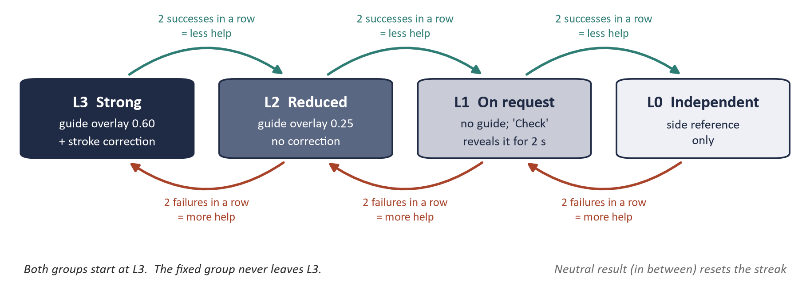</p>

**An unassisted redraw decides the help.** After each line step the user redraws it on a blank canvas
(a *probe*). Each part gets a two-way distance **error** and a **coverage** score:

- ✅ **Success:** error ≤ 0.03 and coverage ≥ 0.80
- ❌ **Failure:** error ≥ 0.06 or coverage < 0.50
- ➖ **Neutral:** anything in between (resets the streak)

Raw strokes are always logged apart from corrected ones, and levels are never shown to the participant.

### 🖥️ Interface

<p align="center">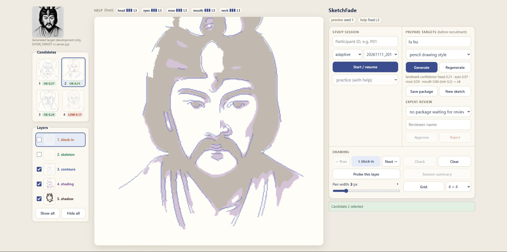</p>

- **Researcher app** (`/`): generate and choose candidates, save and review packages, run sessions, probe a layer.
- **Participant view** (`/participant`): large canvas, one instruction per step, one **Done with this step** button
  that starts the unassisted probe, undo, eraser, 6 pen sizes, palm rejection and timers.

## 🧪 Pilot study results

<p align="center">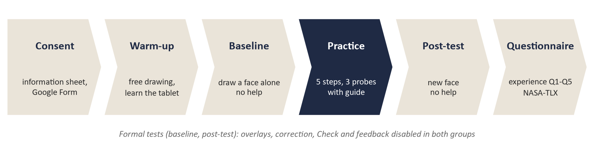</p>

Pilot on **17 November 2026** at JAIST with **three adult novices** on a Surface tablet (finger input):
**P01** fixed guidance (always L3), **P02** and **P03** adaptive fading. All sessions completed, all 9 probes
recorded, **no server errors**.

### 1 · Without help: from symbols to structure

<p align="center">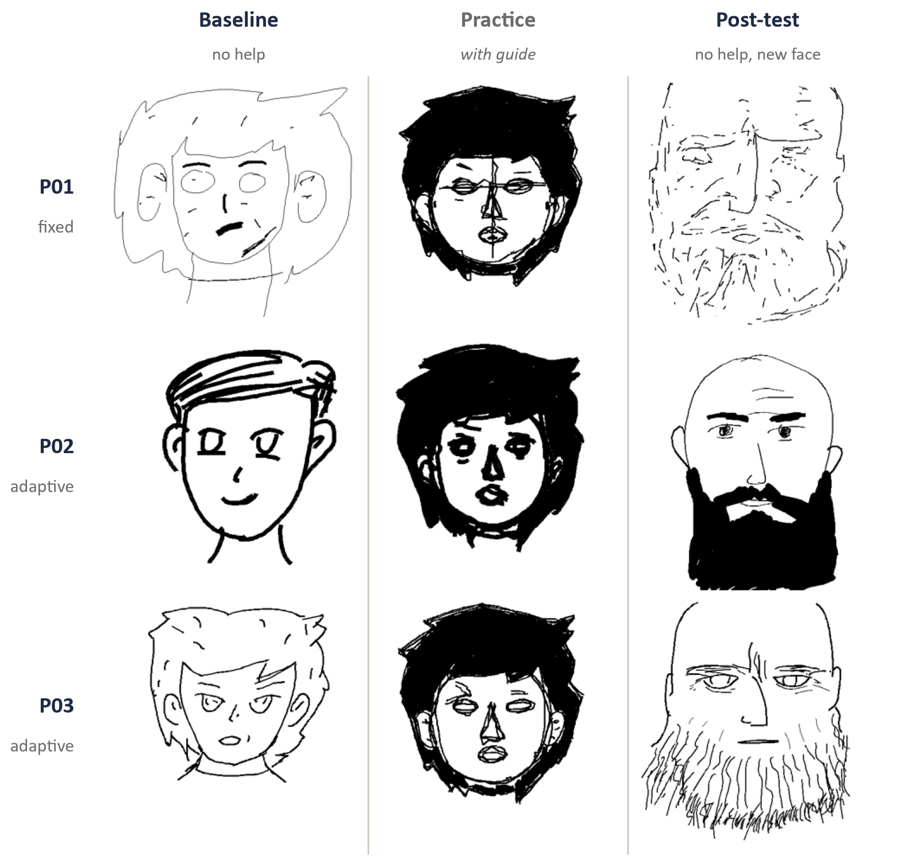</p>

At baseline everyone drew **symbol faces** (cartoon eyes, a dot for the nose, a smile). In the post-test, on a
**new face without help**, they drew **structure**: eyes level at mid-head, a longer nose, better proportions.

### 2 · Line steps were followed, tone steps were skipped

<p align="center">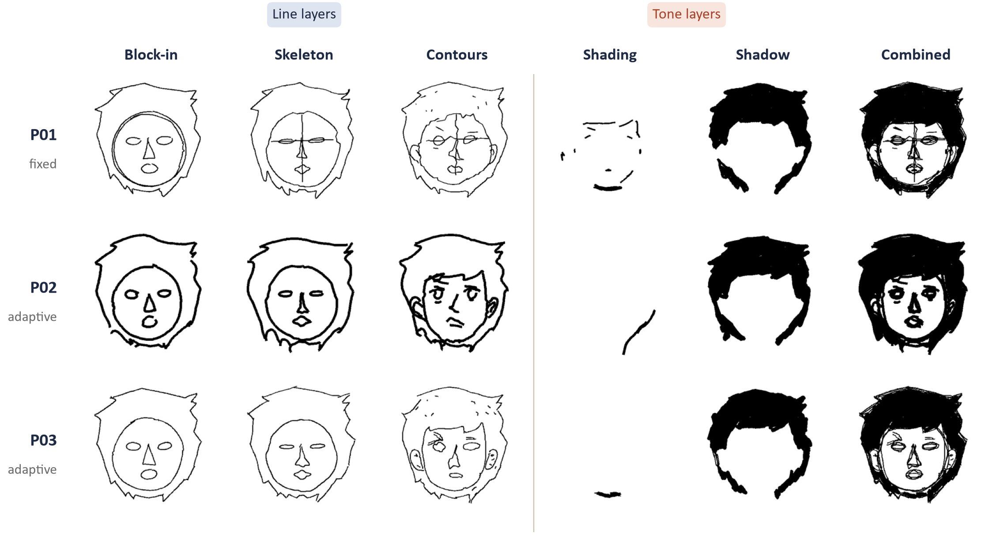</p>

**Line layers teach structure; tone layers need a new design.**

### 3 · The streak rule kept help from fading

<p align="center">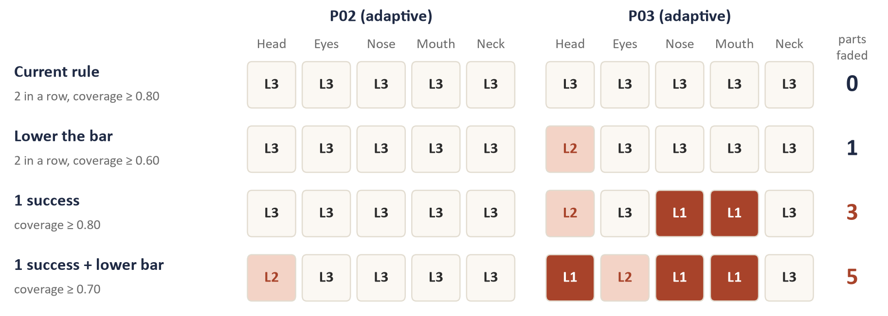</p>

With at most **3 probes per part**, *two successes in a row* almost never happens, so every part stayed at L3.
Replaying the logged probes shows that **requiring one success would fade 3 to 5 parts**.

<details>
<summary><b>Why? A quick probability check</b></summary>
<br>
<p align="center">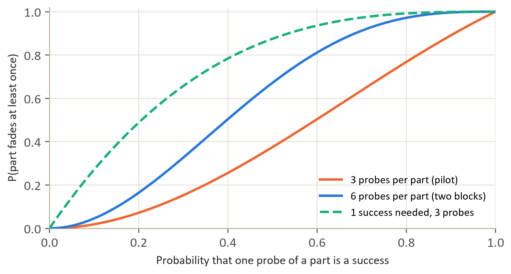</p>

With per-probe success rate *p*, two consecutive successes in three probes has probability *p*²(2 − *p*):
only **15 %** at *p* = 0.3, while a single success gives 1 − (1 − *p*)³ = **66 %**.
</details>

### 4 · Experience and workload

| Item (1–7) | P01 fixed | P02 adaptive | P03 adaptive |
|---|:---:|:---:|:---:|
| Felt like own work | 5 | 2 | 4 |
| In control | 6 | 3 | 4 |
| **Guide helped decide what to draw next** | **5** | **4** | **4** |
| Can start alone | 3 | 4 | 4 |
| Help matched need | 5 | 3 | 4 |

<p align="center">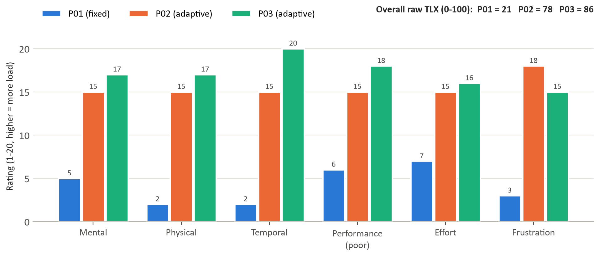</p>

Workload was 21 vs 78 and 86, but all three received the same full help, so this reflects **individual
differences**, not a condition effect.

### Answers (n = 3, descriptive only)

| RQ | Status | Evidence |
|---|:---:|---|
| **RQ1** · Fading | 🔴 Open | The rule never fired, so both groups received the same help. |
| **RQ2** · Guide layers | 🟡 Partly | Line steps were used and carried over to structure; tone steps were skipped. |
| **RQ3** · Experience | 🟡 Partly | Guidance helped (4–5 / 7); fading and candidate choice were not experienced. |

### 🔭 Limitations → future work

| Limitation | Next step |
|---|---|
| Streak rule too strict for 3 probes | **1 success to fade**, more probes per part, simulate the rule on the probe budget first |
| n = 3, one session | ~12 novices in matched pairs, Day 0 / 2 / 7 with delayed retention and transfer |
| Finger input | Stylus with palm rejection |
| Self-ratings only | Two blinded raters with ICC |
| Researcher chose the candidate | Participants choose their own target |
| Tone layers as regions to fill | Value-study steps (2–3 values, hatching) |

## 🚀 Quick start

```bash
git clone https://github.com/DikkiKartajaya/sketchfade.git
cd sketchfade/app
pip install -r requirements.txt     # on an NVIDIA GPU: install the CUDA build of torch first
python generate.py                  # once: downloads the models (~3 GB), makes a test target
python server.py                    # → http://127.0.0.1:9100/  (participant view: /participant)
```

On Windows, double-click **`run.bat`** (macOS: `run.command`). Without `diffusers` the app still runs, using
a ShadowDraw database face as the target, which is enough to try the interface.

<details>
<summary><b>Prepare and review study targets</b></summary>

```bash
python prepare.py "a young woman with short hair" "an old man with a beard" --seeds 6
python package.py list
python package.py review <id> --approve --reviewer "Illustrator name"
```
</details>

<details>
<summary><b>Run on a shared lab GPU server</b></summary>
<br>
<p align="center">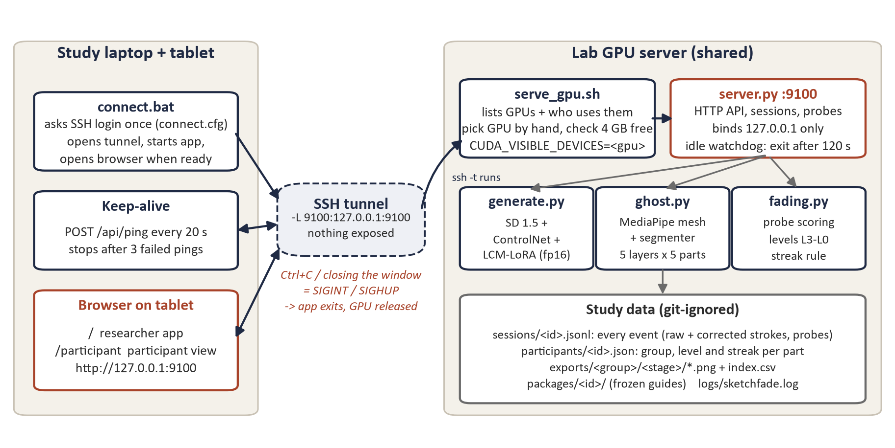</p>

From Windows, double-click **`connect.bat`**: it asks for the SSH login once, lists the server's GPUs, starts
the app on the one you pick and opens the browser. The server only listens on `127.0.0.1`, and an idle
watchdog releases the GPU 120 s after the laptop disconnects. Details in
[`app/README.md`](app/README.md#run-on-a-gpu-server-eg-rtx-6000-ada).
</details>

| Hardware | Time per target |
|---|---|
| NVIDIA RTX 6000 Ada (lab server) | ≈ 1 s |
| NVIDIA RTX 5090 laptop GPU | ≈ 4 s |
| CPU only | ≈ 10–46 s |

Run the tests with `pytest app/tests` (59 tests: fading rules, probe scoring, study API and a full simulated
session in a headless browser).

## 📁 Repository

```
sketchfade/
├── app/                        SketchFade (A + B)
│   ├── generate.py             B · sketch + prompt → hidden target (SD + ControlNet + LCM)
│   ├── ghost.py                B · landmarks, segmentation, 5 layers × 5 parts, confidence
│   ├── package.py              B · frozen guide packages and expert review (CLI)
│   ├── prepare.py              B · batch-generate study targets
│   ├── fading.py               A · probe scoring, levels L3–L0, fading controller
│   ├── server.py               HTTP API, sessions, probes, study logger
│   ├── static/index.html       researcher app
│   ├── static/participant.html participant view (tablet)
│   ├── connect.bat, serve_gpu.sh  remote GPU access
│   └── tests/                  pytest + Playwright
├── shadowdraw-demo/demo/       ShadowDraw re-implementation + face database
└── docs/                       figures and study instruments
```

Study data (`sessions/`, `participants/`, `exports/`) stays on the study machine and is ignored by git.

## 👥 Team

Course project for **I665E Human–AI Interaction Exercise II**, JAIST, 2026.

| | Member | Role | Focus |
|:---:|---|---|---|
| 🧭 | **Muhammad Ariful Furqon** (s2620005) | Concept & method | Study design, fading rule, analysis |
| ⚙️ | **Dikki Yusuf Kartajaya** (s2610043) | System & server | Generation pipeline, drawing app, logging, GPU access |
| 🎨 | **Berlian Angga Kusuma** (s2610055) | UI & user study | Participant view, sessions with participants, data collection |

All members also helped each other across tasks.

## 📚 Built on

- Y. J. Lee, C. L. Zitnick, M. F. Cohen. **ShadowDraw**: Real-time user guidance for freehand drawing. SIGGRAPH 2011.
- E. Iarussi, A. Bousseau, T. Tsandilas. **The Drawing Assistant**. UIST 2013.
- J. Xie et al. **PortraitSketch**: Face sketching assistance for novices. UIST 2014.
- B. Williford et al. **DrawMyPhoto**: Assisting novices in drawing from photographs. C&C 2019.
- S.-Y. Chen et al. **DeepFaceDrawing**. SIGGRAPH 2020 · Z. Huang et al. **AniFaceDrawing**. SIGGRAPH 2023.
- D. Dixon, M. Prasad, T. Hammond. **iCanDraw?** CHI 2010.
- D. Wood, J. S. Bruner, G. Ross. The role of tutoring in problem solving. 1976 · N. C. Soderstrom, R. A. Bjork. Learning versus performance. 2015.
- R. Rombach et al. **Stable Diffusion**. CVPR 2022 · L. Zhang et al. **ControlNet**. ICCV 2023 · S. Luo et al. **LCM-LoRA**. 2023 · C. Lugaresi et al. **MediaPipe**. 2019.

<div align="center">
<br>

*Judge AI drawing help by what people draw once it steps back.* ✏️

</div>
