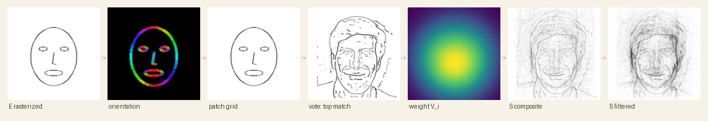

# ShadowDraw (Faces) — Interactive Demo

A self-contained reimplementation of **ShadowDraw: Real-Time User Guidance for
Freehand Drawing** (Lee, Zitnick, Cohen — SIGGRAPH 2011), scoped to face
drawing. As you sketch a face, the system retrieves matching real faces from a
database of 2,175 photos and blends their edges into a faint *shadow* under
your strokes to guide proportions — trace it or ignore it.

This package contains everything needed to **run** the demo. The offline
database-construction pipeline (edge extraction, descriptor indexing) is not
included; the prebuilt database ships in `data/face_db.npz`.



## Requirements

- Python 3.8+
- `numpy` and `Pillow` (nothing else — the web server uses only the standard
  library)

```bash
pip install numpy Pillow
```

## Run

**Easiest — double-click:**

- **macOS:** double-click `run.command` (if macOS blocks it the first time,
  right-click → Open → Open).
- **Windows:** double-click `run.bat`.

The launcher installs `numpy`/`Pillow` if needed, starts the server, and opens
your browser at http://127.0.0.1:9000/. Close the terminal window (or press
Ctrl+C) to stop.

**Or from a terminal:**

```bash
python3 server.py            # serves on http://127.0.0.1:9000/
python3 server.py 8080       # or pick another port
```

Then open **http://127.0.0.1:9000/** in a browser and start drawing.

## Using the UI

- **Pen / Eraser** — draw or erase strokes (dark-blue marker style).
- **Undo / Clear** — remove the last stroke / start over.
- **Shadow: on/off** — toggle the guidance shadow.
- **Shadow strength (λ)** — how strongly the shadow shows.
- **Save session** — writes your stroke log to `sessions/*.json`.
- The shadow updates automatically as you draw (~0.5–0.9 s per update); it is
  strongest near the cursor.

### Pipeline inspector

Click **Pipeline** to expand a panel that visualizes the full computation, in
the paper's notation, for the current drawing:

1. **Ẽ rasterized** — your strokes as the 300×300 edge image the engine matches.
2. **(θ̃, m)** — the estimated edge-orientation field (hue = angle).
3. **patch grid** — the 17×17 query grid; blue cells vote, orange cells were
   recomputed on the last update (incremental voting). Click a cell to see its
   BiCE descriptor and its top database-patch matches.
4. **vote histogram** — top images and, per image, the 9×9 offset heatmap.
5. **C: d, hᵢ, vᵢ** — the top-6 aligned candidates with their displacement
   d, global match score hᵢ, weight vᵢ, Tx/Ty alignment curves, and spatial
   weight map Vᵢ.
6. **S = Σ WᵢE′ᵢ** — the running weighted composite: column *k* is the shadow
   after adding the top-*k* candidates.
7. **S̃ (eq. 12)** — the final display-filtered shadow.

Use **Freeze** to hold the current snapshot while you inspect it, and the
**cells / top-1 alignment** checkboxes to overlay the grid and the best
candidate's aligned edges directly on the canvas.

## Files

| Path | What it is |
|------|------------|
| `server.py` | Standard-library HTTP server + image encoding for the UI |
| `engine.py` | `ShadowEngine`: retrieval → alignment → weighting → shadow |
| `bice.py` | BiCE descriptor + packed-bit Jaccard matching |
| `static/index.html` | The drawing UI (single file, no build step) |
| `data/face_db.npz` | Prebuilt database: 2,175 images, 171k BiCE descriptors, edge bitmaps |
| `sessions/` | Saved stroke logs (created on first Save) |

## How it works (brief)

Each database face is stored as a 1-px long-edge image. Offline, every image is
cut into a 9×9 grid of 60-px patches and each patch is encoded as a 432-bit
**BiCE** descriptor. Online, your strokes are rasterized and described on a
17×17 grid; descriptors are matched by Jaccard similarity, votes accumulate per
image and offset, the top candidates are finely aligned with a 1-D Hough
refinement, spatially-varying weights are computed from edge-orientation
agreement, and the weighted edge images are summed into the shadow. See the
paper for the full method.

## Credits

Method: Yong Jae Lee, C. Lawrence Zitnick, Michael F. Cohen, *ShadowDraw*,
ACM SIGGRAPH 2011. Face photos are scaled crops in the Caltech-faces style.
This is an independent educational reimplementation.
